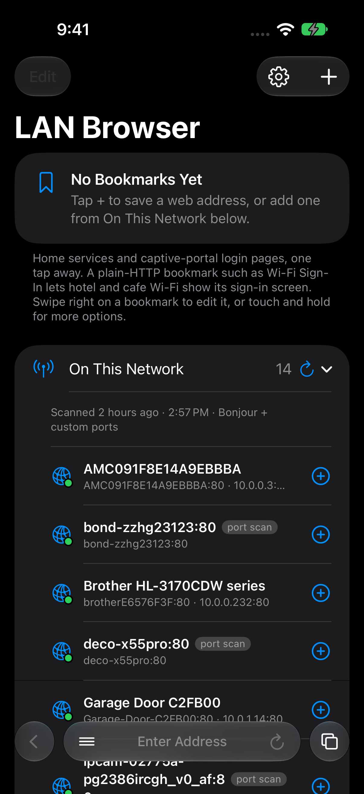
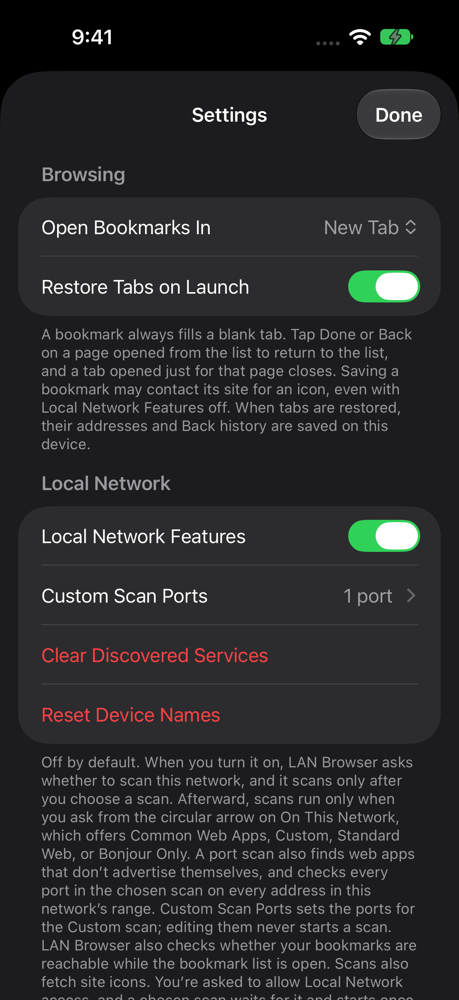
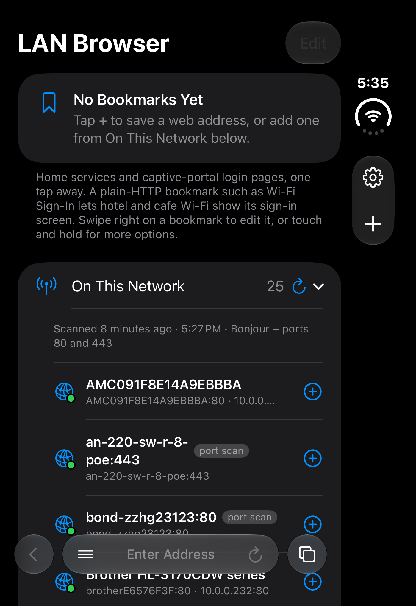
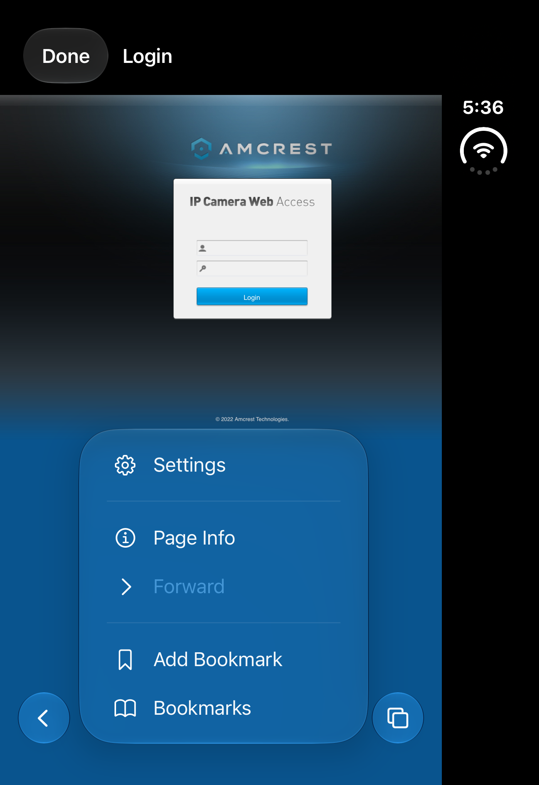
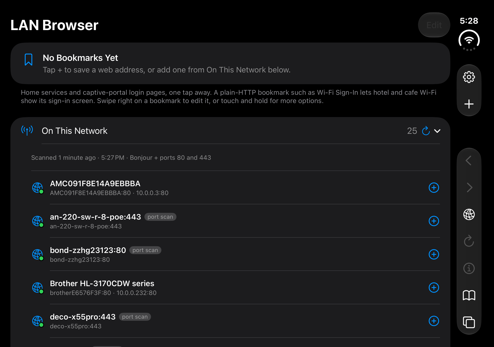
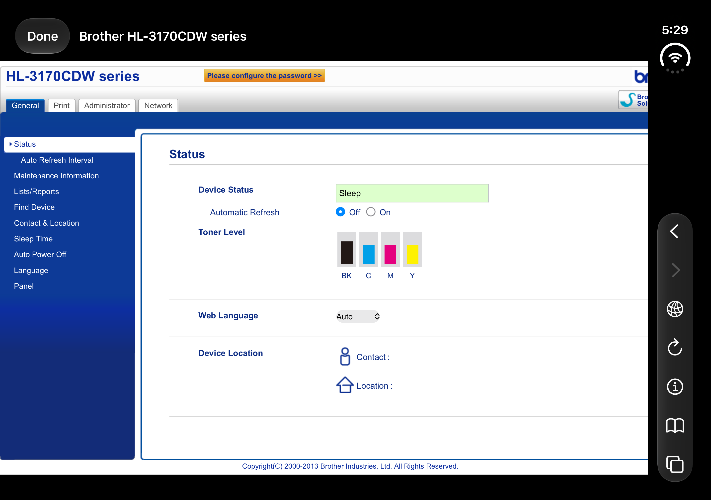
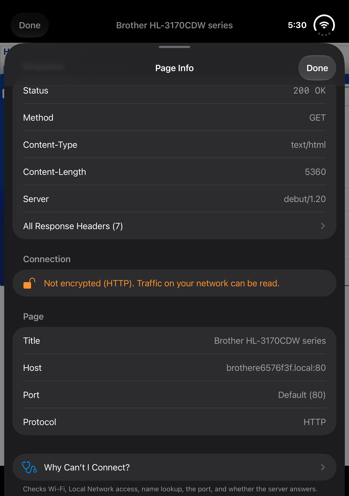
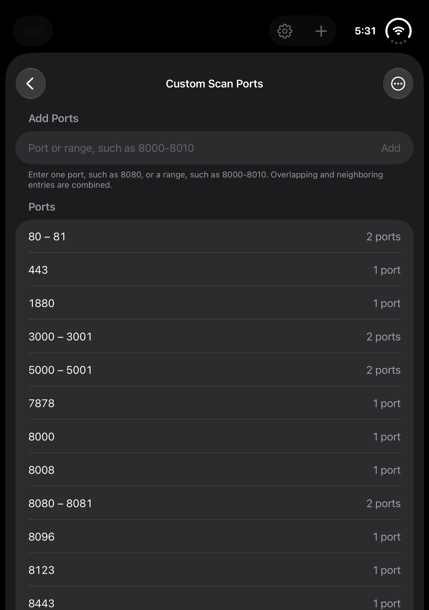

# LAN Browser

[](https://github.com/jessegoodier/lan-browser/actions/workflows/ci.yml) [](https://github.com/jessegoodier/lan-browser/actions/workflows/codeql.yml) [](https://scorecard.dev/viewer/?uri=github.com/jessegoodier/lan-browser) [](LICENSE)

A small iPhone and iPad browser with tabs for home services and captive-portal Wi-Fi. It requires iOS or iPadOS 26.0 or later. The same iPad app runs on Apple silicon Macs with macOS 26 or later, and that build is what the Mac App Store lists. Intel Macs cannot run it. It is built with SwiftUI and WebKit and has no dependencies.

LAN Browser is free and will never have paid features, subscriptions, or ads.

Plain HTTP is intentional. Home servers often have no certificate, and hotel, cafe, train, and airport networks show a sign-in page by intercepting an HTTP request. [wifi.makesmart.ai](http://wifi.makesmart.ai/) is a plain-HTTP page for that case. Add it from **Settings › Public Wi-Fi** as **Wi-Fi Sign-In**. The app contacts that site only when you open it.

LAN Browser is for trusted home networks. It isn’t meant for banking, email, shopping, or other sites you expect to be secure. It loads plain HTTP, and it opens devices on your network even when their certificates aren’t trusted. On a network you don’t trust, use Safari. The first launch shows **For Trusted Home Networks** until you tap **I Understand**. The same text is at the top of **Settings › Help & Support › Using LAN Browser**.

## Screenshots

### iPhone 18 Pro

<table>
  <tr>
    <th>On This Network</th>
    <th>Settings</th>
  </tr>
  <tr>
    <td align="center"><a href="docs/screenshots/iphone-18-pro-network.png"></a></td>
    <td align="center"><a href="docs/screenshots/iphone-18-pro-settings.png"></a></td>
  </tr>
  <tr>
    <td align="center">iPhone 18 Pro · Dark appearance</td>
    <td align="center">iPhone 18 Pro · Dark appearance</td>
  </tr>
</table>

### iPhone Duo · Closed

<table>
  <tr>
    <th>On This Network</th>
    <th>Camera Login &amp; Browser Menu</th>
  </tr>
  <tr>
    <td align="center"><a href="docs/screenshots/iphone-duo-closed-network.png"></a></td>
    <td align="center"><a href="docs/screenshots/iphone-duo-closed-camera-menu.png"></a></td>
  </tr>
</table>

### iPhone Duo · Open

<table>
  <tr>
    <th>On This Network · Landscape</th>
    <th>Printer Web Interface · Landscape</th>
  </tr>
  <tr>
    <td align="center"><a href="docs/screenshots/iphone-duo-open-network-landscape.png"></a></td>
    <td align="center"><a href="docs/screenshots/iphone-duo-open-printer-landscape.png"></a></td>
  </tr>
  <tr>
    <th>Page Info · Portrait</th>
    <th>Custom Scan Ports · Portrait</th>
  </tr>
  <tr>
    <td align="center"><a href="docs/screenshots/iphone-duo-open-page-info-portrait.png"></a></td>
    <td align="center"><a href="docs/screenshots/iphone-duo-open-custom-scan-ports-portrait.png"></a></td>
  </tr>
</table>

Select a screenshot to open the full-resolution image.

## What you can do

- A fresh install has no bookmarks. The start page and new tabs show the bookmark list. **Settings › Public Wi-Fi** adds **Wi-Fi Sign-In**.
- The address bar sits at the bottom on iPhone and in a narrow window, and at the top on a full-width iPad or Mac. An address without a scheme uses HTTP. Explicit HTTPS and redirects work.
- Back, Forward, Reload, Stop, and swipe navigation. A page opened from the list shows **Done**. Back returns to the list when that page has no earlier history, and a tab opened only for that page closes.
- Add, edit, delete, and reorder bookmarks on the device. Saving an address you already have opens it for editing. Scans never remove saved bookmarks.
- Website cookies and storage persist. Open tabs can be restored at launch. There is no separate browsing-history list.
- Downloads go through **Save to Files**. Keep the app open until the save finishes.
- **Offer to Save Passwords** and **AutoFill Saved Passwords** are on by default. Passwords stay in this device’s Keychain, are available only while it is unlocked, and are not synced to iCloud or copied to another device. Delete them in **Settings › Saved Passwords** before deleting the app; Keychain entries can remain after the app is removed. Saving a password does not encrypt HTTP. Embedded sign-in frames, HTTP login dialogs, and some custom forms are skipped.
- On iPhone, the bottom bar has **Back**, a pill with **Menu**, the address, and **Reload/Stop**, then **Tabs**. The menu holds Bookmarks, Add Bookmark, Forward, Page Info, and Settings. On iPad, Mac, and an unfolded iPhone Duo, Bookmarks and Return to Page are in the toolbar. Swipe right or long-press a bookmark to edit. Long-press also has **Rename Device…**. Swipe left to delete.
- Rows show the port, including `:80` and `:443`. IPv6 addresses are shown in brackets, such as `[fd00::1]:8888`.
- Saving a bookmark can fetch its icon from that site, which may ask for Local Network permission even with **Local Network Features** off. **Wi-Fi Sign-In** is never fetched or status-checked. Icon requests stay on that site and send no cookies or saved passwords.

## iPad and Mac

A full-width window on iPad or Mac uses a top bar: Back and Forward, the address field, then Reload, Page Info, Bookmarks, and Tabs. A narrow window uses the bottom bar.

With a hardware keyboard, on iPad and on a Mac:

- **⌘L** Open Location
- **⌘T** New Tab
- **⌘W** Close Tab
- **⌘R** Reload
- **⌘.** Stop
- **⌘[** Back
- **⌘]** Forward
- **⌘D** Add Bookmark
- **⌘⇧\\** Show All Tabs
- **⌘,** Settings

On a Mac, Local Network access is in **System Settings › Privacy & Security › Local Network**. The app has no **Open Settings** button there. A Mac has no pull-down gesture, so refresh On This Network with the circular arrow on that row.

In Xcode, run it with **My Mac (Designed for iPad)**.

## Tabs

A new tab opens on the bookmark list. A bookmark or an On This Network row opens in a new tab, or fills the current tab when that tab is blank. Change the default in **Settings › Open Bookmarks In**. Long-press a bookmark for the other choice. Links that ask for a new window open a new tab.

**Tabs** opens a grid of page thumbnails, with ✕ to close one, **New Tab**, and **Done**. Long-press the Tabs button for **New Tab** and **Close Tab**. Closing the last tab leaves one blank tab.

**Restore Tabs on Launch** is on by default and saves open tabs on the device. A restored tab loads when you switch to it. Turning the setting off, or **Clear Cookies & Website Data**, deletes the saved tabs.

## Finding devices on your network

**Local Network Features** is off until you turn it on, from the card on the bookmark list or from Settings. Turning it on asks **Scan This Network?** when nothing is saved. **No Scan** runs nothing. Later, a scan starts only when you ask: the circular arrow on On This Network, or a pull down on iPhone and iPad.

The choices are **Common Web Apps** (22 ports), **Custom**, **Standard Web** (ports 80 and 443), and **Bonjour Only**. **Custom** uses the ports in **Settings › Local Network › Custom Scan Ports**. Until you have opened that page once, the choice reads **Set Up Custom Scan…** and opens the page without scanning. A port-scan choice shows how many ports and addresses it will check and how long it could take, then starts after the sheet closes. It checks every selected port on every address in this device’s own network. A network of more than 1,024 addresses is limited to the 254 addresses around the device. A large scan can take several minutes. **Cancel** keeps the previous results.

If Local Network access is still undecided, the row says “Waiting for permission…” and the scan starts after you allow it. If access stays off, the row explains where to turn it on.

**On This Network**, below your bookmarks, lists web apps found by Bonjour or by the port scan. A bookmarked host is hidden only on the port you saved, so another service on that device still appears. **+** saves the entry: a Bonjour row keeps the host name, and a port-scan row keeps the IP address. The last scan stays on the device until you scan again or choose **Clear Discovered Services**. The app does not rescan on its own when you join another network. Swipe a row to hide it until the next scan.

Status dots show whether a bookmark’s host and port accept a connection. They appear only while the list is open and the feature is on. **Wi-Fi Sign-In** is never checked.

Rename a device from Page Info or **Rename Device…**. One name covers every bookmark on that host.

Scans and status checks stay on your network. Diagnostics contact only the address you ask about. None of that is sent to the developer.

## When a page fails

- Any main-page response other than 200 is shown, as a strip above the page or as an error screen. Those responses are not saved as downloads. The status code is the one the server sent. The reason phrase is the standard phrase for that code.
- A failed load shows the system message, the error domain and code, and the URL.
- Ports that browsers refuse to open, such as 22 or 25, are explained instead of leaving a blank page.
- An HTTPS page on a local address with an untrusted certificate still opens, with a red “!” you can tap for the certificate details. Internet sites with invalid certificates are rejected.

**Why can’t I connect?** checks the network, Local Network access, name lookup, the port, and the web server, including redirects. Open it from Page Info, **Diagnose** on the error screen, or **Check Connection** on a bookmark. **Copy Report** copies a summary. Remove private addresses before posting it.

## Settings

**Settings** on the bookmark screen has six groups: **Browsing**, **Local Network**, **Passwords**, **Public Wi-Fi**, **Privacy**, and **Help & Support**. Privacy includes **Clear Cookies & Website Data** and the offline privacy policy. Help includes **Using LAN Browser**, an offline **Run Browser Check** with a sample download, and **Ask for Help or Report a Problem**.

## Privacy

The app has no analytics, ads, accounts, or backend. Bookmarks, device names, scan results, open tabs, and saved passwords stay on the device. Websites you open have their own practices, and HTTP is not encrypted. The [privacy policy](LANBrowser/privacy_policy.md) is also shown in the app under **Settings › Privacy Policy**.

## Building from source

Requirements: Xcode with the iOS 26 SDK or later. There are no dependencies to install.

1. Open `LANBrowser.xcodeproj` and select the **LANBrowser** scheme.
2. In **Signing & Capabilities**, choose your own **Team**.
3. Change the bundle identifier from **com.jesse.lanbrowser** to one you control.
4. Choose an iPhone or iPad simulator, a connected iPhone or iPad, or **My Mac (Designed for iPad)**, and press **⌘R**. Installing directly on an iPhone or iPad requires Developer Mode (**Settings › Privacy & Security › Developer Mode**).

To build for the simulator without a signing team:

```sh
xcodebuild -project LANBrowser.xcodeproj -scheme LANBrowser \
  -destination 'generic/platform=iOS Simulator' -derivedDataPath build/dd \
  CODE_SIGNING_ALLOWED=NO build
```

An unsigned build cannot be installed on a device or uploaded to TestFlight.

## Troubleshooting

More help is in [SUPPORT.md](SUPPORT.md).

### If a home service does not load

- Open **Why can’t I connect?** and see which step fails.
- If Local Network access is off, turn on **LAN Browser** under **Settings › Privacy & Security › Local Network** on iPhone or iPad, or **System Settings › Privacy & Security › Local Network** on a Mac.
- Try the same address in Safari. If the name fails and the IP works, fix home DNS or edit the bookmark to use the IP.
- Confirm the service listens on the LAN, the firewall allows the port, and the device is not on a guest network.
- A local device with an untrusted certificate still opens, marked with a red “!”. An internet site with an invalid certificate is rejected.

### If a captive portal does not appear

- Add **Wi-Fi Sign-In** from **Settings › Public Wi-Fi** and open it. Stay on `http://wifi.makesmart.ai/`. An HTTPS address usually produces a certificate warning instead of the login page.
- Join the Wi-Fi network again, then reload. Some portals intercept only the first plain-HTTP request after you join.

## Testing

```sh
Scripts/check.sh
```

That compiles the Foundation-only logic and lints the property lists and the Xcode project. It does not launch WebKit. Manual checks are in [docs/TESTING.md](docs/TESTING.md).

## Security

Report vulnerabilities privately, as described in [SECURITY.md](SECURITY.md).

## Support

For help, see [SUPPORT.md](SUPPORT.md).

## Contributing

Issues and pull requests are welcome. Project layout and conventions are in [AGENTS.md](AGENTS.md).

## License

LAN Browser is released under the [MIT License](LICENSE).
